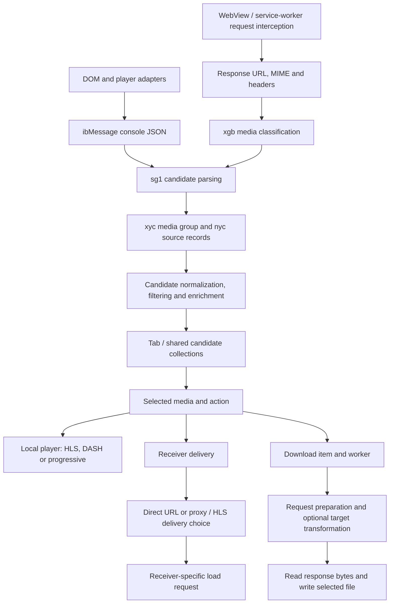

# Android media pipeline: code investigation

This connects retained implementation files into a pipeline. Evidence is static unless explicitly stated in older research documents. **No new application, playback, download or browser tests were run for this checkpoint.** The user's requested investigation-only phase remains in effect.

## Overall flow

This is an architecture map, not proof that every edge between action selection and receiver preparation has been exhaustively traced. Discovery/representation and concrete playback/download/receiver endpoints are identified. The complete central dispatch and all receiver-specific transformations remain work items.

## 1. Discovery: two complementary entry paths

Full JavaScript: `extracted/android/assets/ibfunctions.js`, especially ibFindAllVideos, ibSendListOfVideos, ibSend. It inspects HTML media elements/source children, subtitles, fallback links, metadata and player APIs. ibSend emits marked JSON through console logging. These results are candidates, not guaranteed playable media.

Native receiver: `working/media/sg1.java` and authoritative `working/apktool/smali_classes6/sg1.smali`; earlier `prior-analysis/class-sg1.java` has existing readable anchors. onConsoleMessage identifies messages and dispatches page data, videoList, play events, provider payloads and m3u8Segments. Method t processes video lists. A validateHls candidate can enter gpb validation; other candidates do not necessarily take that check.

Network path: `working/native/xgb.java`, methods g/h/l and shared `yxc.c`. Content-Type, Content-Length, response URL and redirects can yield media candidates even when DOM discovery does not expose a useful source. Specific transport segments and site cases are filtered. This is neither universal network capture nor raw packet capture. WebView and service-worker entry contexts differ; see ANDROID_BLOCKING_GAPS.md.

## 2. Candidate data model and normalization

`working/native/xyc.java` is a group/container with an array of nyc sources. `xyc.c`:

- Rejects blank source strings.
- Consults configurable URL-replacement criteria (mec), applying a matched replacement.
- Selects/normalizes MIME through configured criteria and helpers, with fallback inference.
- Constructs a nyc source, avoids an equal source already in the group, and starts follow-up enrichment tasks for relevant source types.

`working/native/nyc.java` stores URL (h), MIME (i), byte-length/other metadata and headers in a case-insensitive TreeMap. Its equals/hashCode use URL and MIME, not the entire header map. Therefore equality is not evidence that two authorization contexts or sessions are interchangeable. The group-level merging behavior still needs complete tracing.

Header addition `nyc.a` filters Range from retained context, merges into a case-insensitive map, and applies site-dependent context/header adjustments. Its configuration keys include android_modify_headers and android_origin_header_required. The returned b() is a fresh case-insensitive map. This is substantial context handling rather than simply remembering a URL. Exact precedence among page-derived, intercepted, cached and site-specific headers remains a separate audit target.

`sg1.c` constructs groups from network results and uses cached request context from jd9, including a Referer fallback where appropriate. It copies tab-related flags into the candidate group. Do not infer field semantics solely from obfuscated names.

## 3. Filtering and shared collections

`working/media/toc.java`, b: compares candidates against existing media records and recognized segment matchers for a collection context. It also applies configurable android_videos_to_ignore criteria with pageUrl, videoUrl and mimeType inputs. A matching ignore criterion suppresses the candidate; the syntax/boolean implementation should be checked in raw instructions for any individual rule.

`working/media/qmc.java`:

- b removes sources rejected by toc.b and merges cached headers for surviving URLs.
- a schedules collection ingestion rather than directly updating every UI inline.
- f examines HLS candidates, filters recognized child manifests and certain provider-specific URLs, and schedules further playlist/media inspection. It also schedules subtitle-related enrichment on another branch.
- c/d expose collection-context views; timestamp/context behavior needs full dispatch/callback tracing before assuming all tab lifetimes are identical.

`sg1.b` sends nonempty groups to d; d posts gy0 case 5. Exact UI ordering, group deduplication and per-tab/shared-list reconciliation are not yet fully mapped. toc and qmc show that an exported list of every request URL would not reproduce the application's curated media list.

## 4. Validation, inspection and stream distinctions

`working/native/gpb.java` and raw gpb.smali implement URL-plus-headers keyed HLS validation, 30-second result cache and bounded entries. It reads a limited first line and compares against #EXTM3U after BOM handling. This is playlist-header validation, not confirmation that every segment, rendition, subtitle and receiver can play.

`working/media/toc.java`, a, parses playlist text into structured tags/URI records. Other downstream parsers and enrichment callbacks remain to be connected. A master playlist, a media playlist, one segment, a DASH manifest, a blob URL and a progressive MP4 require different handling. The candidate model and MIME classifiers preserve some of these distinctions; do not collapse them into a generic “captured video.”

## 5. Proxy delivery and HLS transformations

Existing core files: `working/native/zfa.java`, `my6.java`, `uda.java`, `ag8.java`, and both full MediaProxyServlet classes. zfa stores original URL and header context in a proxy registry and returns an indirect URL. MediaProxyServlet can generate loopback or other local-server bases. The serial HLS transformer resolves/replaces segment and URI-attribute addresses and passes request context into generated proxy URLs. Parallel/remote-selected modes also exist; they are not assumed behaviorally identical.

Newly traced **separate endpoint**: `working/media/com_instantbits_android_utils_web_hls_M3U8ToTSServlet.java`. m generates a /m3u8tots/ address through the proxy registry. s serves a MPEG content response, handles HEAD/OPTIONS separately and delegates playlist delivery to ko4.l. `working/media/ko4.java` retrieves/parses playlists, processes segment/range information and writes segment input bytes to the response. Its a method has explicit HTTP success checks, read/write loops and a conditional key/decrypting-stream branch. Ordinary encrypted-HLS handling is not evidence of Widevine/license/DRM bypass. This investigation does not exercise protected streams or provide a bypass implementation.

Do not call the above general-purpose transcoding. Playlist rewriting changes manifest text; codec declaration edits are metadata changes; sequential TS delivery is a distinct operation. Whether a particular output is usable as one file depends on selected format/path and stream structure. fMP4, discontinuities, alternative audio, live refresh and subtitles need their own branch audit.

`working/media/coc.java` wraps selected nyc/xyc data and generates a loopback proxy URL with source headers, including a special content:// case. Its existence does not establish that every cast uses loopback, which would not be reachable from another receiver. Receiver-facing base selection must be traced separately.

## 6. Concrete local-player endpoint

`working/media/com_instantbits_cast_webvideo_player_InternalPlayerService.java`, the media preparation branch around 622–695, selects Media3 HlsMediaSource for HLS, DashMediaSource for DASH and ProgressiveMediaSource otherwise. It also contains optional cache-data-source handling and subtitle composition paths.

This is media playback, not screen recording. Its dependencies and cache paths should not be confused with ad SDK player classes elsewhere in the APK. Complete input construction from every action and player-error/fallback path remains to be mapped.

## 7. Concrete receiver endpoint: Google Cast

`working/media/com_instantbits_cast_util_connectsdkhelper_googlecastconnectsdk_GoogleCastService.java`, M, unpacks URL/MIME/title/subtitle/poster and stream data from d77, then posts df4. l forwards to M at initial position zero.

The authoritative body is `working/apktool/smali_classes6/df4.smali`; JADX suppresses this synthetic class as DONT_GENERATE, so it is retained as smali rather than inventing Java. It constructs MediaMetadata, receiver custom data (including corsServer, live-stream and HLS.js-related hints), MediaInfo and MediaLoadOptions, then invokes `RemoteMediaClient.q(MediaInfo, MediaLoadOptions)` around line 710 and installs a result callback. This confirms a receiver load instruction built from prepared media metadata; it is not phone-screen streaming.

The adapter's track-change methods separately send receiver messages or select active media tracks. Other adapters exist: e.g. FireTVService invokes the Amazon RemoteMediaPlayer setMediaSource API. Their presence does not establish identical supported formats, headers, subtitles or fallback behavior. Full route-through-phone decision dispatch and per-receiver URL construction remain open.

## 8. Actual file download: selection, job and byte sink

`working/media/i57.java` / earlier decoded i57, method a: creates an ACTION_CREATE_DOCUMENT intent with MIME, suggested filename and openable category. It retains a DownloadItem pending the chosen document. This is a user-selected file destination, distinct from displaying a detected source URL.

`working/media/n33.java` toString and constructor identify the DownloadItem record fields: id, file, URL, incognito flag, download type, target format, web-page address, headers, status, error, downloaded bytes, total bytes, transformation progress and timestamps. It is not merely a URL/filename pair.

Raw `working/apktool/smali_classes6/z8.smali` around 1730–2010 constructs a WorkManager request targeting DownloadWorker with input data after inspecting task state. The full UI-result → persistence → scheduling chain still needs a dedicated call-site trace.

`working/media/com_instantbits_cast_webvideo_download_DownloadWorker.java`, e, opens the document with ContentResolver, applies the Wi-Fi preference gate, checks the URL, selects target-format preparation and passes stored headers into request preparation. It recognizes local M3U8ToTSServlet bases in a special path. This is evidence that format preparation may precede saving, not proof all HLS downloads use one transformation.

**Byte sink is verified in raw code:** DownloadWorker.smali, c (1213 onward). It examines selected file stat size, adds a Range request for existing data above its threshold, reads response headers including Content-Length/Content-Range, wraps the supplied descriptor in FileOutputStream, and loops InputStream.read → FileOutputStream.write around 2426–2453 while maintaining progress. JADX fails to reconstruct c, so raw instructions are the evidence. Resume offset checks, server ignores-range responses, truncation and cancellation need full branch tracing before claiming robust resume under every server behavior.

DownloadWorker.d handles processing/cancellation/error paths around the copy operation and persists resulting state through qo8 helpers. Record creation, job execution and local-player caching are different mechanisms. No actual download was started.

## 9. What “capture” means here

There are now concrete paths for discovery, source metadata/context retention, proxy-assisted media delivery, receiver instructions, local playback and saving response bytes. None of these by itself means screen recording. No screen-recording implementation has been established in the inspected path; this is not an exhaustive negative claim about the entire app.

A browser-extension design would need independent implementations of candidate inspection, context handling, filtering, manifest processing and delivery/storage. Android's WebView/native HTTP/file-provider/receiver access does not automatically carry over to an extension. No extension was built during this checkpoint.

## 10. Remaining static investigation before testing

1. Complete sg1 JSON dispatch and candidate field semantics; follow gy0 case 5 and qmc scheduled callbacks to final list merge/order.
2. Trace all site/player adapters, dynamically loaded scripts and blob/MSE handling. Record provider-specific assumptions separately.
3. Resolve exact header precedence and lifetime across nyc, jd9, proxy records, downloaded-item persistence and receiver handoff.
4. Complete central action → d77 → direct/proxy/M3U8ToTS decision path, including subtitle/audio tracks and each receiver adapter.
5. Trace ko4 playlist/segment refresh, byte ranges, live stop conditions, alternate renditions, discontinuities and transformation branches.
6. Trace document-result persistence and WorkManager constraints, retry/cancel behavior, response-code/resume validation and each target-format strategy.
7. Examine protected-media rejection/licensing boundaries without assuming a visible manifest is downloadable.

Keep these as code questions until investigated; testing is deferred at the user's request. This is a substantial connected checkpoint, not a claim of complete static reconstruction.

## 11. Central dispatch and download-format checkpoint

Static inspection only; no application, stream, receiver or download test was run.

### Selected source → prepared playback → destination

`working/media/y97.java`, u, requires the chosen URL to resolve through `xyc.i`. Missing sources are logged and rejected. It reads `qt1.u()` (the previously mapped always-use-in-app-player preference) and selects x versus h, with an exception for media kind `c77.d`. Preserve that enum distinction rather than assuming every candidate follows the preference.

Both h and x call l, which constructs an asynchronous `upa` through `w87`/`ppa` and installs different callbacks. j constructs a `yp3` playback record from the group and chosen source. It copies source headers, obtains current cookies through `ku7.k`, and places the cookie string under `Cookie` before populating the playback record headers. Full precedence across every proxy and receiver still requires further tracing.

H is a concrete local playback handoff: it unbinds an existing service when necessary, stops InternalPlayerService, assigns `InternalPlayerService.B = yp3`, and launches InternalPlayerActivity. This connects prepared source metadata to the player described above.

i calls `WebVideoCasterApplication.L(d77, xo8)` for remote loading. Raw WebVideoCasterApplication.smali records L's remote-device load entry and a separate downstream invocation of `v67.g0(d77, xo8, int)` in its surrounding loading implementation. The intermediate callback chain and adapter dispatch remain open; proximity is not treated as proof of a direct call. Google Cast's terminal MediaInfo/load instruction was established separately in section 7.

### Download format strategies

`working/media/c43.java` declares the following target formats and strategy assignments:

| Target | Request preparation | Post-transform |
| --- | --- | --- |
| ORIGINAL | p98 | none |
| TS_FROM_M3U8 | py6 | none |
| MP4_FROM_MPD | none assigned here | ihb case 1 |
| MP4_FROM_M3U8 | none assigned here | ihb case 1 |
| UNKNOWN | fallback helpers | none |

These are declared code branches, not a tested compatibility matrix. No claim of universal transcoding, DRM removal, or successful processing of arbitrary HLS/DASH follows from the enum.

p98.a preserves URLs matching two application endpoint prefixes. For URLs classified by i57.g/h as manifests, it keeps the URL, copies supplied headers, and obtains a Cookie value asynchronously through ku7.j. Otherwise it calls MediaProxyServlet.A to prepare an indirect URL. Thus ORIGINAL does not always mean a direct, header-free network request. py6.a sets the supplied request URL and its download user-agent; this method alone does not convert a playlist into TS. The earlier M3U8ToTSServlet/ko4 path must be connected to the caller that supplies this URL.

ihb.f parses the source URI, dispatches rh3 asynchronously to produce a temporary File, copies that file to the selected destination URI through xb case 3, and deletes the temporary file on success or copy failure. The transformation engine, track selection, output limits and cancellation path remain under investigation. Raw rh3.smali contains multiple merged synthetic cases, including Media3 transformer construction; the matching case must be resolved before attributing all those instructions to this download branch.

### Document picker result

i57.f handles result request 6294, requires a pending download record and nonempty selected URI, takes persistable URI permission with flags 3, constructs an updated n33 record using the chosen URI, launches lz3 case 15, and clears the pending reference. This closes the picker-to-coroutine step. lz3's persistence and scheduling calls remain to be matched to z8's verified WorkManager enqueue implementation.

### Evidence and remaining work

Full reconstructed Java plus authoritative raw smali are retained under `code-evidence/android/media/action-dispatch-and-formats/`. Exact indexed windows accompany the full files. Some synthetic classes cannot be reconstructed by JADX; their smali remains the evidence.

Next: resolve w87 and the h/x callback cases; trace WebVideoCasterApplication.L through v67 into each adapter; trace lz3 case 15 into persistence and scheduling; match rh3's URI/MIME constructor to its exact transformation case; then audit target-format availability, live handling, range/resume and cancellation. These remain static code questions before any testing.

## 12. Resolved export branch and download persistence

This checkpoint supersedes section 11's uncertainty about which rh3 case the MP4 strategy reaches. It does not resolve every export option or worker scheduling trigger.

### MP4 branch reaches Media3 export

Raw `working/apktool/smali/rh3.smali`, URI/String/Context/callback constructor, sets discriminator r=3. `invokeSuspend` maps case 3 to pswitch_4 (3282 onward); that branch extends to the Media3 transformer construction around 5493–5621. This verifies the connection rather than relying on a library import elsewhere in the APK. The reconstructed `working/media/rh3.java` also maps case 3 to L166.

The branch constructs media input using the supplied URI and MIME, wraps it in an edited-item/composition structure, creates a temporary file through dd case 11, sets an export listener through il7 and an asynchronous continuation, and builds the export object with the temporary path. It constructs `androidx.media3.transformer.c` and initiates the export machinery; a separate lz3 case 17 coroutine is also launched. When the continuation returns a File, the already documented ihb.f stage copies it into the selected document URI and deletes the temporary file.

This supports describing the MP4 strategies as Media3-based export branches. It does not establish whether each input is remuxed or decoded/re-encoded, what codecs are selected, or which live/encrypted/adaptive inputs succeed. Those depend on builder defaults, track requirements and lower-level factories still to be inspected. No FFmpeg dependency or screen recording is inferred from this path. The continuation registers bh0 case 6; its body dispatches fi0 case 15 with the export object. Exact cancellation, listener error propagation and temporary-file cleanup before successful export remain open.

### Picker result has two branches

`working/media/lz3.java`, invokeSuspend case 15 (L185), reads the pending n33 source URL. Sources beginning `/` or `content://` take a local-copy coroutine, r90 case 10. A true result launches q33 case 3 and displays an added message; false produces an unavailable-input/output error and APDW001. Other URLs launch xb case 24. This is a real local/network distinction, not one common HTTP download path.

q33 case 3 uses its default invokeSuspend branch: it constructs a copy of n33 with status b43.e and calls l53.a. The network branch, raw xb invokeSuspend case 24, also calls l53.a with its n33 record before showing the added message. The semantic name of b43.e is not assigned here until its enum is checked.

### Persistence endpoint

Raw l53.a constructs k53 case 0 and launches it asynchronously on he4.a. k53 case 0 reaches its mapped pswitch_1, obtains i53, copies the n33 array and calls the database transaction helper with f53 case 0. f53 case 0 uses i53.b (h9) and xv7.g0. The h9 SQL statement explicitly contains:

`INSERT OR REPLACE INTO DownloadItem (id,file,url,incognito,downloadType,targetFormat,webPageAddress,headers,status,errorMessage,downloadedBytes,totalBytes,transformationProgress,added,updated)`

Thus the network-result → asynchronous record insertion path is now connected. The toast appears after scheduling insertion, not after awaiting a completed transfer or proving the database transaction succeeded. The previously verified z8 branch constructs DownloadWorker work requests, but the observer/dispatcher linking database state to this scheduler still needs to be traced. Do not draw a direct l53.a → WorkManager call edge without that intermediate evidence.

### Next static gaps

- Resolve database-observer → scheduler linkage and enumerate initial/retry/cancel statuses.
- Trace Media3 export listener completion/error, cancellation and temporary-file cleanup.
- Establish export muxer/codec defaults and when remuxing versus encoding is selected.
- Continue receiver routing and direct/proxy/HLS-to-TS selection before testing.

Full files are retained under `code-evidence/android/media/download-persistence-and-export/`, with indexed exact excerpts and SHA256 provenance. No behavioral test was run.

## 13. Database observer → worker scheduling and export outcomes

Static inspection only. No app, network-media, receiver, or download behavior was executed.

### The missing scheduler connection is resolved

The verified chain is:

`document result → lz3 case 15 → xb case 24 → l53.a → k53 case 0 → f53 case 0 → DownloadItem insertion → database observer → n82 case 6 → z8 case 3 → DownloadWorker request`

The previous sections established insertion. Newly inspected raw files establish observation and scheduling:

- `u33.smali` initializes its lazy manager with ue2 discriminator 22. `ue2.smali` constructs the manager and launches eh3 case 8 during initialization.
- `eh3.smali` obtains the DownloadItem DAO, uses the database invalidation/query machinery with table name DownloadItem and query callback g53, and subscribes r33 wrapping n82 discriminator 6. `g53.smali` contains the list query `SELECT * FROM DownloadItem ORDER BY added DESC`; its exact discriminator must be retained when comparing other queries in that merged class.
- `n82.smali` maps case 6 to pswitch_16. It casts the callback value to a List and the captured manager to u33, then launches z8 with discriminator 3 and that list.
- `z8.smali` case 3 examines download records, validates destination availability via q33, switches on status, and creates a DownloadWorker request for QUEUED records. DOWNLOADING and TRANSFORMING contribute to its active-count branch. Further concurrency limits and all recovery transitions still need a complete branch table.
- The request includes input data, tag/name `download-<id>`, zero initial delay, an explicit-backoff-criteria flag and a 10,000 ms backoff value. It is submitted through o4d/d4d. Enum names/policy semantics should be resolved before describing exact retry or duplicate-work behavior.

The observer is established during manager initialization, not by a direct call from every insertion. This explains how asynchronous persistence feeds scheduling without inventing a direct l53 → WorkManager call.

### Download status enum resolved

| Field | Name | Ordinal |
| --- | --- | --- |
| b43.d | PAUSED | 0 |
| b43.e | COMPLETE | 1 |
| b43.f | FAILED | 2 |
| b43.g | QUEUED | 3 |
| b43.h | DOWNLOADING | 4 |
| b43.i | WORK_SCHEDULED | 5 |
| b43.j | TRANSFORMING | 6 |

This resolves section 12's unnamed b43.e: successful local copying is recorded as COMPLETE. It must not be confused with the initial status of a network download. Enum membership alone does not establish every valid transition.

### Export completion, failure and cancellation

`il7` retains the waiting l81 continuation and temporary File. The callbacks are implemented in merged helper classes rather than methods declared on il7 itself:

- `nv8.smali`, invoke(Object), logs transformation completion and calls `l81.resumeWith(temporaryFile)`.
- `mh5.smali`'s transformation-error callback logs the export exception message, wraps the exception in cr9 (failure carrier), and resumes the same continuation. The original throwable is preserved in that carrier.
- rh3 registers bh0 discriminator 6 as the continuation cancellation handler. That branch dispatches fi0 discriminator 15 with the s2c export instance, using its specified coroutine context/start mode. `fi0.smali` case 15 calls `s2c.b()` within an Exception catch. The lower-level release/cancel implementation in s2c.b still needs inspection; the call itself is confirmed.

The success path now connects export → File continuation → ihb destination copy → temporary-file deletion. ihb's try/finally deletion scope begins after the export coroutine returns the File. It therefore does not, by itself, prove temporary files are deleted when export fails or is cancelled before that return. No cleanup bug is asserted: cancellation/export internals and temporary-file management may handle it elsewhere.

### Remaining static work

Complete the scheduler's concurrency and state-transition table; resolve duplicate-work and backoff policy enums; trace s2c.b and export-failure temporary-file ownership; resolve muxer/codec defaults and actual remux versus encoding conditions; continue receiver direct/proxy and HLS-to-TS selection. Full files and indexed line windows are preserved in `code-evidence/android/media/scheduling-and-export-lifecycle/`.

## 14. Scheduling policy, retry, export selection and delivery routes

### Scheduler and retry policy

`working/media/z8.java`, invokeSuspend case 3, re-reads each observed item by id before validating its output and choosing an action. QUEUED creates work, persists WORK_SCHEDULED, and continues iterating. DOWNLOADING and TRANSFORMING increment an active counter. There is no active-count concurrency cap in this inspected loop; after processing it calls the manager's background-resource path when count > 0, or its release path otherwise. This is not a guarantee of unconstrained execution: Android/WorkManager impose their own scheduling constraints.

Work input is KEY_DOWNLOAD_ITEM_ID; tag/name is download-<id>; initial delay is zero. zh0.b resolves to LINEAR and its backoff value is 10,000 milliseconds. `d4d.a` labels the enqueue operation EnqueueRunnable_KEEP. This establishes the selected KEEP-labelled continuation path, but duplicate-work race behavior still depends on the enqueue transaction implementation and must not be inferred solely from the diagnostic label.

DownloadWorker entry accepts only WORK_SCHEDULED or FAILED records with a nonblank URL; an absent or differently staged record returns eq6. fq6.toString identifies Retry; eq6.toString explicitly identifies Failure; hq6.a creates Failure and hq6.b creates gq6 (Success). Worker.e returns Retry for w33 retryable failures and IOExceptions when getRunAttemptCount() <= 10; above 10 it returns eq6 while retaining the failed record/error state. This is the exact code condition, not a promise of precisely ten total executions. Non-success HTTP responses in c become w33; the inspected code does not split 4xx into permanent and 5xx into retryable errors. Separate v33 definitive failures are recorded and return hq6.a. User cancellation in d stores PAUSED and returns eq6 (WorkManager Failure). Foreground notification setup is attempted before transfer.

### Resume validation limit

DownloadWorker.c adds Range: bytes=<existing size>- if the destination stat size is > 2. It checks the response's general success flag, opens the byte sink, logs Content-Range, and uses parsed Content-Length plus existing size for total progress. In this method the Content-Range string is logged rather than parsed to validate the returned starting offset, and no explicit 206-versus-200 resume gate was found. This is a static robustness concern when a server ignores Range, not an observed corruption result. Its consequences depend on the document provider/open-file semantics and HTTP interceptor behavior. Do not advertise reliable arbitrary-server resume based on the Range header alone.

### MP4 export and codec selection

rh3 uses default q2c transformation-request/encoder settings and replaces its muxer factory with j85. q2c constructs the encoder factory through to2(qo2), while j85 writes a FileOutputStream through fl7 and k85. The file factory in dd case 11 builds `<app cache>/output_<current milliseconds>.mp4`, ensures the directory exists, and deletes an already existing path before returning it. This is a named cache file, not an automatically managed java.io temporary file.

The bundled Media3 method `androidx/media3/transformer/TransformerInternal$SequenceAssetLoaderListener.shouldTranscode` provides the real per-track decision. It considers available encoded/decoded input support, composition/sequence structure, encoder factory requirements, requested output MIME, muxer MIME support, audio processors and video transformations. Its video path also inspects pixel aspect ratio and effects. Consequently MP4 export can take transmux or transcode branches depending on the source and requested transformations; it is not always a re-encode or always a lossless remux.

to2 enumerates device MediaCodecInfo encoders, filters/selects configurations, and raises an explicit error when no MIME is supported by both encoder and muxer. Therefore the actual codec/capability result depends on the device; static packaging cannot yield a universal successful-codec table. fl7's video support list includes AV1, H.263, AVC, HEVC, MPEG-4 Visual, VP9, APV and Dolby Vision; the audio list includes AAC and other entries. These are muxer-advertised input types, not proof each phone can encode them or each receiver can play them. Exact supported lists remain in the full fl7 file.

### Export cancellation and temporary-file ownership

s2c.b calls wo2.a for active export, clears the active object and invokes s2c.c on both normal and exceptional paths. wo2.a signals the internal Media3 engine under its synchronization lock; s2c.c cancels its watchdog future and shuts down the watchdog executor. Thus the earlier cancellation call reaches engine teardown rather than only dismissing UI.

No file-delete instruction occurs in the inspected rh3 export branch, s2c teardown, or its completion/error continuation callbacks. ihb deletes the returned file after destination copy or copy failure, but its deletion scope begins after export returns. A failed/cancelled export may therefore leave a cache artifact unless another cache-maintenance path removes it. This remains a scoped static finding; a whole-app cleanup search is needed before claiming a leak. Neither success nor cleanup was executed.

### HLS-to-TS builders and receiver handoff

The missing TS download caller is `e57.onClick`, discriminator 0: it chooses c43.TS_FROM_M3U8, wraps the HLS source with MediaProxyServlet.B (including source headers), then passes that proxy URL to M3U8ToTSServlet.m and invokes the callback with generated URL and format. py6 subsequently prepares that generated URL. This connects UI format selection → proxy → TS endpoint → download worker rather than mistaking py6 for a converter.

For receiver HLS conversion, y97.b dispatches wi5 case 1. wi5 wraps the source with MediaProxyServlet.B and retained playback headers, then M3U8ToTSServlet.m with stream descriptor and stream.ts. y97.b replaces the playback URL with that result, sets MIME video/MP2T and resumes the route decision through y97.I. The boolean controlling address selection is passed from receiver capability methods; their names must be resolved before assigning a universal device meaning.

MediaProxyServlet.A explicitly produces 127.0.0.1 proxy URLs. B instead calls C, which selects dv4.t versus dv4.r. These are separate address-selection paths. Thus local download/inspection and external receiver delivery must not be collapsed into a single loopback endpoint.

w87.call directly invokes y97.j, resolving the previously open asynchronous preparation edge. After remote-load setup, zyc sets receiver context/cors address, copies prepared headers into wnc's shared map, and resolves an address asynchronously through bzc callbacks. At the receiver dispatcher, v67.g0 posts p4 case 3, which checks device connection and either stops previous playback through a callback or calls e0 directly. e0 handles image-specific preparation, otherwise f0. f0 normalizes HLS MIME to application/vnd.apple.mpegurl and video/x-mpegts to video/mp2t, retains playback state, obtains ca7, and calls M for position-aware playback when supported or l otherwise. This connects the common dispatcher to the already traced Google Cast and Fire TV terminal methods without assuming all adapters have the same capability set.

### HLS live refresh

ko4.k distinguishes master and media playlists, selects a master rendition through b, iterates media-sequence numbers, skips sequences already delivered, resolves source/proxy URLs, and writes segments through a. For non-ended lists it returns the last sequence; l repeatedly retrieves/parses the playlist until the returned sequence is negative or a fetch/body exception stops the operation. k includes a bounded sleep branch and an optional trailing-window skip branch. This is ongoing playlist/segment delivery, not a single manifest download. Discontinuity, fMP4 initialization, alternate-audio and exact rendition-selection policy require the field-specific parser/selector audit before claiming full support.

## 15. Edge-case audit and corrected policy definitions

### WorkManager results and builder flag verification

The result classes are now verified by their own definitions: fq6 is Retry; eq6.toString is Failure; gq6 is Success; hq6.a creates Failure and hq6.b creates Success. Earlier working notes identifying eq6 as Success were incorrect and section 14 was corrected. App-level status and WorkManager outcome are distinct: cancellation stores PAUSED but returns Failure; retry exhaustion stores failure information and returns Failure. Successful completion uses hq6.b.

The v60.b boolean set in the scheduler is **backoff criteria configured**, not expedited execution: v60.b() uses it to reject custom backoff on idle-mode work. Actual expedited state is b5d.q. The scheduler inspected here sets the backoff flag and LINEAR delay, not the expedited field. Earlier wording in section 13 was corrected. No expedited or out-of-quota behavior is established by this path.

ci3.a performs the unique-work-name transaction check. For a nonempty name with no prerequisites, it queries existing work and returns without inserting when a matching state is m4d.a or m4d.b, which the enum defines as ENQUEUED and RUNNING. This supports the KEEP behavior beyond its diagnostic label. Existing finished work follows a different replacement/cleanup branch. The normal path is database-transaction guarded by its caller; this is static implementation evidence, not a stress-test of racing callbacks.

### Address selection resolved

dv4.r constructs `http://<ku7.n host>:<dv4.o port>`, adding IPv6 brackets when the host contains a colon. dv4.s separately produces 127.0.0.1. dv4.t constructs an HTTPS host/port when its vv4 feature/configuration gates permit, otherwise falls back to r. Thus MediaProxyServlet.B can produce a network-interface address while A explicitly selects loopback. Actual reachability, certificates, active interface and receiver trust depend on runtime conditions.

bzc's success and fallback callbacks both call WebVideoCasterApplication.K. K wraps existing absolute-path files and content:// documents through LocalFileServlet, checks the selected route flag and manifest-like URLs, invokes application proxy preparation where the route requires it, and then calls v67.g0 with the playback record. This closes zyc → bzc → K → v67.g0 → p4 → e0/f0 → adapter M/l. It does not mean every original URL is proxied.

### HLS segment, rendition and protected-media boundaries

ko4.b sorts master variants using qq discriminator 21. Its comparator reads format.k and sorts larger values before smaller values; b starts at that first variant and can choose a lower-k variant when measured jo4.a throughput is below the selected value. It uses previous measured transfer throughput rather than a universal fixed quality choice. Exact field units and threshold behavior must be kept tied to this bytecode rather than generalized to all ABR players.

ko4.a passes segment fields j and i to its range-capable request builder. ko4.e emits a Range value from its numeric arguments when the bound is nonnegative. This establishes byte-range plumbing, not a tested guarantee for every playlist range layout or origin response. Non-2xx segment responses are logged and skipped by returning -1; absent bodies and stream failures throw. The live loop has last-sequence tracking, end-marker termination and an optional near-live trailing-window skip branch.

In the inspected ko4 delivery methods, there are no reads of bo4.b (the segment's initialization-segment reference), bo4.d (its discontinuity-related numeric field), or bo4.f (DrmInitData). The loop writes segment streams consecutively; it does not explicitly prepend initialization data or implement discontinuity remuxing. Therefore fMP4/EXT-X-MAP, discontinuity transitions and external alternate-audio composition cannot be claimed as supported by this TS endpoint from the inspected code. Native Media3 playback/export has a separate parser/loader pipeline and should not inherit this limitation automatically.

The segment key/IV path uses `se`, whose InputStream wrapper instantiates AES/CBC/PKCS7Padding with an AES SecretKeySpec and IvParameterSpec. This is conventional full-segment encrypted-HLS processing when a usable key is already retrievable. The path does not inspect DrmInitData or implement a license exchange. SAMPLE-AES, Widevine/FairPlay and protected playback are not equivalent to this AES segment wrapper; no license or DRM bypass is established.

### Temporary-file audit conclusion

The output_ prefix occurs in the inspected app DEX at the export file-creation helper. That helper creates output_<timestamp>.mp4 directly in app cache. Targeted checks of export, success/error continuation and cancellation paths found cleanup after returned-file copy, engine resource teardown and watchdog cancellation, but no deletion before export returns. This closes the question of *what the inspected lifecycle guarantees*: deletion after copy is explicit; deletion after pre-return export failure/cancellation is not guaranteed by that lifecycle. Generic cache eviction or app-wide maintenance could still remove artifacts, so this is a documented ownership gap rather than proof of a permanent leak. A dynamic artifact-lifetime check is deferred.

### Receiver-specific coverage

`results/android-receiver-adapters.json` indexes direct ca7 implementors, their M/l entry methods, exact line ranges and outgoing invocation instructions. The inventory found nine direct implementors; inherited services and subclasses are explicitly outside that direct-implementation count.

| Adapter | Confirmed dispatch distinction |
| --- | --- |
| Google Cast | l forwards to position-aware M; df4 builds receiver MediaInfo/load options and submits receiver load |
| Fire TV | l calls Amazon RemoteMediaPlayer.setMediaSource; M is an Error stub and must not be selected as supported |
| DLNA | l builds protocol/media metadata and delegates to its helper/callback path; M is an Error stub |
| Netcast | l delegates to its DLNA service with an adapter callback; M is an Error stub |
| WebOS | l prepares service/helper dispatch; M is an Error stub |
| AirPlay | M gathers source/metadata and creates fi dispatch; l forwards to M |
| Abstract TV receiver | M collects source/metadata and launches m4; l forwards to M; subclasses determine protocol details |
| Roku | RokuServiceBase declares ca7 through its hierarchy; RokuChannelService supplies M/l and uses H0/F0 channel URL/query helpers |
| rxc helper | l constructs a media helper request; M is an Error stub |

The table is a source-level dispatch map, not a receiver compatibility or playback-success matrix. Some adapters deliberately lack position-aware M; v67 capability selection is material. Deep protocol-specific callbacks, receiver firmware behavior and subtitle compatibility are separate questions from connecting the common application pipeline.

## 16. Discovery and context checkpoint

[Android discovery and context audit](ANDROID_DISCOVERY_AND_CONTEXT.md) connects JS adapters and HLS candidate validation to native context/shared-list merge, ordering, lifecycle removal and header precedence. It also separates the additional site-specific manifest/session adapter from ordinary source discovery and ko4 AES delivery. Resource hashes match the supplied APK. No behavioral tests run.

## 17. Final HTTP context checkpoint

[HTTP context and proxy engines](ANDROID_HTTP_CONTEXT.md) traces the final stored/cache/cookie/header sequence, engine selection, authentication interceptor, automatic versus servlet-visible redirects, and response-cookie persistence. This extends the source-context audit without assuming every request uses the same client. Static investigation only.

## 18. Lifecycle and subtitle checkpoint

[Lifecycle/injection](ANDROID_LIFECYCLE_AND_INJECTION.md) and [subtitles](ANDROID_SUBTITLE_PIPELINE.md) extend the connected map through navigation cleanup, script selection, storage-path discovery and receiver subtitle delivery. Shared-map eviction and uninspected receiver/parser branches remain explicitly open. Static investigation only.

## 19. Subtitle formats and retention checkpoint

[Subtitle format/receiver details](ANDROID_SUBTITLE_PIPELINE.md) and [retention policies](ANDROID_MEDIA_RETENTION.md) distinguish live subtitle commands from initial metadata, parser conversion from compatibility, and per-context removal from shared/proxy aging. Static analysis only.
