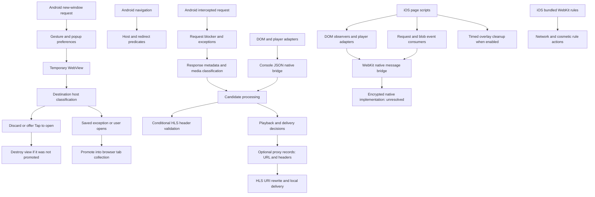

# Component map

The arrows describe traced relationships; they do not mean every navigation or cast takes every path. iOS native behavior is intentionally left unresolved.

Machine-readable evidence: `results/mechanism-map.json`, supplemented by the earlier `results/blocking-map.json`. Source paths in the new map are relative to the research root. The HLS/casting arrow indicates available delivery code, not a measured end-to-end cast.
