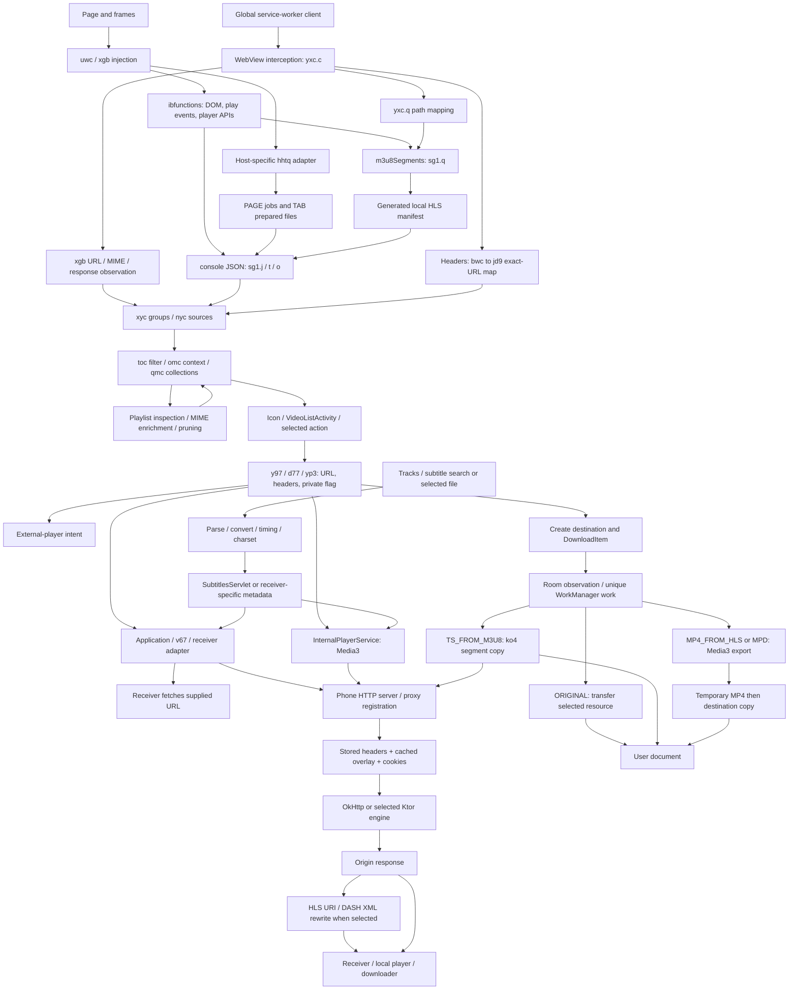
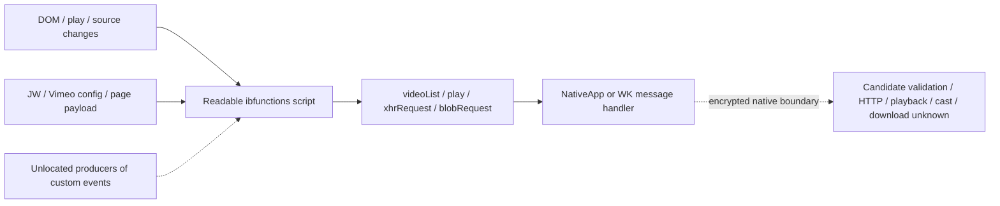

# Connected media architecture

Current static audit, 2026-10-17. Applies to the supplied Android 6.0.3 APK and iOS 3.5 build 0 IPA, not matched releases. See [current gaps](MEDIA_GAPS.md), [detailed audit](MEDIA_STATIC_AUDIT.md), [techniques](MEDIA_METHOD_INVENTORY.md), [platform comparison](MEDIA_PLATFORM_COMPARISON.md), and [implementation relevance](MEDIA_IMPLEMENTATION_RELEVANCE.md). No application or injected-script execution was performed.

## Android: producers to delivery

Arrows identify code paths, not a requirement that every item traverse every box. In particular, some downloads fetch a manifest directly, some origin URLs are proxied, and local/content files bypass origin HTTP. A service-worker request can enter the shared pipeline without the WebView/frame context available to an ordinary callback. A proxy URL denotes registration and routing; it does not imply that media has already been fetched.

`omc` identifies a page context. `qmc.b` holds context-specific groups; `qmc.c` is a separate shared list. `nyc` stores individual sources. URL/MIME identity omits credentials, so context association and header merging must be considered separately from deduplication. Page reset removes one context and PAGE resources; it does not establish global cleanup of headers, segment mappings or proxy records. The ownership map and limits are in [retention](ANDROID_MEDIA_RETENTION.md) and the new audit.

## iOS: the readable boundary

The iOS script itself performs some requests and can serialize a Blob as a data URL. That does not establish native reception, storage, playable segment recovery, or parity with Android. Readable bundled web-receiver scripts are a separate receiver implementation, not readable iOS phone-side native code.

## Terms used throughout the audit

| Term | Established meaning here | Does not establish |
| --- | --- | --- |
| Source detection | Observe a DOM/player/network URL or metadata | That URL is currently authorized or playable |
| Obtaining a playable URL | Construct/select a source with enough context for a delivery attempt | Universal codec, DRM, expiry or receiver support |
| Proxying | A phone HTTP endpoint fetches/rewrites/serves resources | A saved file, transcoding, or prevention of page requests |
| Casting | Dispatch media metadata and commands to a receiver adapter | Screen mirroring or receiver success |
| Original download | Transfer bytes from the selected resource, sometimes through proxy routing | That a manifest becomes a self-contained movie |
| Segment assembly | The custom HLS-to-TS path copies selected segment streams in sequence | General fMP4 handling, independent audio muxing, or full HLS conformance |
| Remux/transmux | Change a container while keeping encoded samples, when Media3 chooses that path | That every export avoids decoding/re-encoding |
| Transcoding/export | Media3 may decode and encode tracks when its checks require it | Availability of every device codec or DRM bypass |
| Screen recording | Capture rendered display/audio frames | Not established as a connected media save path in this audit |
